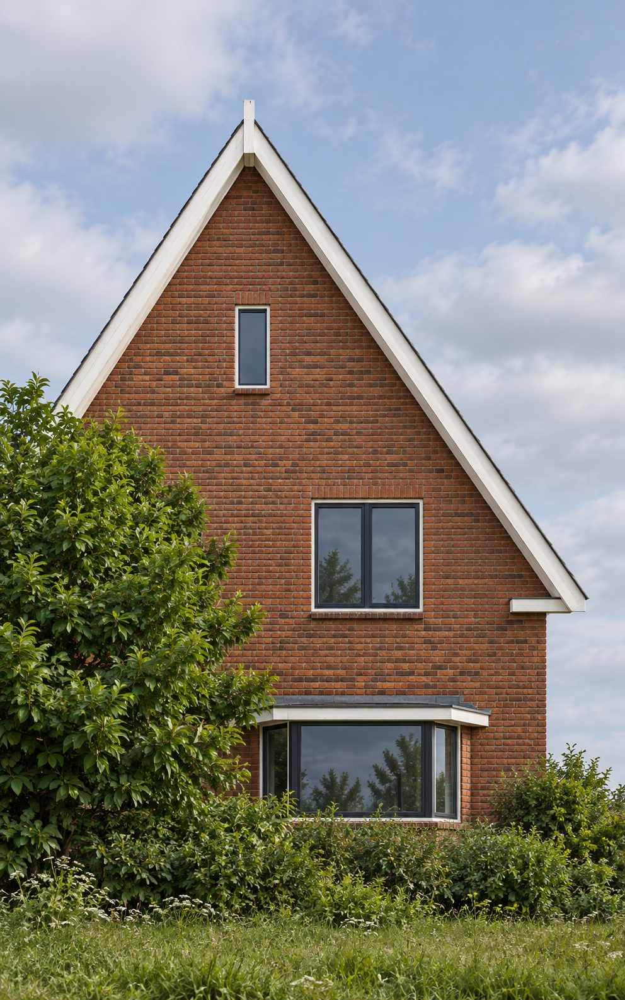
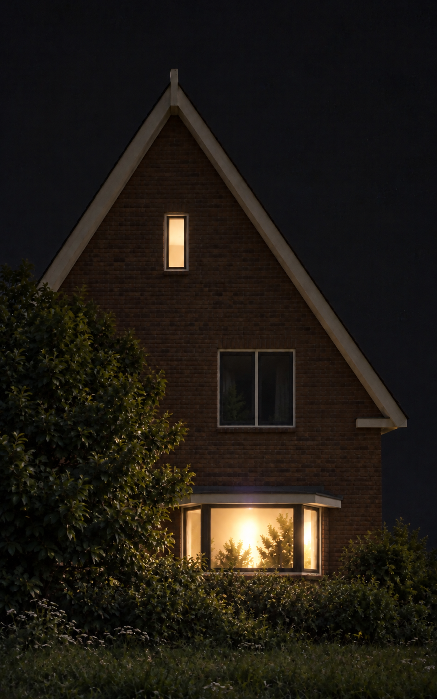

# Nightfall

An offline desktop tool for Halloween house projection mapping on Linux and Windows. Align polygon contours to a house, preview animated effects, and export matching 800 × 1280 portrait videos. The interface and documentation are in English.

| Day reference | Night reference |
| --- | --- |
|  |  |

These are AI-generated examples based on the example configuration's polygon layout. The night example uses a real night photograph only as a reference for lighting, exposure and phone-camera quality; its fictional house and composition come from the generated example, and the streetlight is omitted. The example preserves the configured roof, windows, bay and foreground tree; it still needs alignment on a real projector.

## Run a downloaded executable

Download the Linux or Windows archive from **Releases**, or from a **build** run under **Actions**, and extract the entire `nightfall` folder. Keep the executable and `_internal` folder together.

- **Windows:** open `nightfall.exe`.
- **Linux:** run `./nightfall`. The `.tar.gz` archive preserves its executable permission.

The **Windows 11 64-bit package is self-contained**: Python, Qt, NumPy, FFmpeg, FFprobe, the effects and the example configuration are included. Extract the ZIP and double-click `nightfall.exe`. No Python installation, codec installation, administrator access or internet connection is needed to use it. Keep the complete extracted folder together.

The Linux build requires **FFmpeg with libx264** on your system for video export and MP4 playback. Live previews work without it. Alternatively, place `ffmpeg` and `ffprobe` in a `bin` folder alongside the executable.

On Ubuntu/Debian, install `ffmpeg libegl1 libopengl0 libxcb-cursor0`. On Fedora, use an FFmpeg package with the libx264 encoder and install `mesa-libEGL`, `libglvnd-opengl` and `xcb-util-cursor` if needed.

## Run from source

Use Python 3.14 and install FFmpeg for video export and playback:

```bash
python -m venv .venv
# Linux:
.venv/bin/python -m pip install -r requirements.txt
.venv/bin/python -m nightfall
# Windows:
.venv\Scripts\python -m pip install -r requirements.txt
.venv\Scripts\python -m nightfall
```

`./start.sh` and `start-windows.bat` provide shortcuts. Open your own configuration by passing its path:

```bash
.venv/bin/python -m nightfall path/to/house.json
```

`calibrate.py` remains a compatibility launcher. Personal configurations can contain embedded photographs: store them in `private/` and keep them out of Git.

## Align and play

Set the projector's extended desktop to **800 × 1280**, portrait, at **100%** scaling. Open a mapping with **Open**, select a corner or contour, and drag to adjust it. The reference image stays on the laptop. The projector receives only the masked output.

- Arrow keys move by 1 pixel; Shift moves by 10 pixels; Ctrl moves by ¼ pixel.
- Tab selects the next corner. Ctrl+Z undoes an edit; Ctrl+S saves.
- The wheel zooms, the middle button pans, and `0` fits the view.
- **Reference: day/night** switches reference images without changing projector geometry.
- **Projector on** enables output; clicking it again blacks out the projector. Esc hides the output.
- **Video → Open video file…** plays an existing MP4. **Preview on this screen only** keeps playback and the FPS readout on the main screen without opening fullscreen projector output. The large readout reports frames actually painted by the app over a two-second window; it does not measure the monitor refresh rate.
- **Video** also starts an effect or the Halloween tour. The tour changes from the children's show to the braver visitors' show at the configured local time.
- **Render video** exports both two-minute shows from the current mapping. It becomes **Stop render** while rendering. Completed videos remain intact when a render is cancelled.

Smoke uses a fixed 50% strength. The old lamp-post placeholder is removed when older projects are opened because the street light is outside the projector coverage.

Glass, the bay front and exclusion masks stay black as configured. A window needs a reflective screen before it can receive projection. Save your aligned mapping and matching `.alignment.png` together. Reference images are embedded when a loaded project is saved, so personal projects remain portable.

Packaged builds keep render caches in `%LOCALAPPDATA%/Nightfall/renders` on Windows and `${XDG_DATA_HOME:-~/.local/share}/Nightfall/renders` on Linux. Source runs use `renders/` in the project directory.

## Test playback on this computer

Open an existing video directly, with a visible main-screen FPS counter:

```bash
./start.sh --preview-only --video path/to/video.mp4
```

On Windows, use `nightfall.exe --preview-only --video path\to\video.mp4`. The player preserves the source video's cadence; it does not generate extra frames to turn 30 fps video into 60 fps. Live preview renders effects on demand and is measured separately from video playback.

Rendering defaults to one or two CPU workers, drops to one when available memory is low or cannot be measured, and limits encoder threads. No dedicated GPU is required. An older computer may render slower than real time: render the shows first, then play the completed videos. A 60 fps file does not guarantee 60 displayed frames per second on every computer; use the FPS counter to check the target machine.

## Offline export

```bash
.venv/bin/python -m nightfall --render examples/house.json --out videos --show both
```

Use `--seconds 2` for a short preview, `--workers 2` to limit CPU workers, or `--patterns-only` to export alignment patterns without FFmpeg. Outputs include the mapping snapshot and a manifest with geometry, source and asset hashes. Existing files require an explicit `--overwrite`.

For a packaged build, use `./nightfall --render ...` or `nightfall.exe --render ...`.

## Development and builds

```bash
QT_QPA_PLATFORM=offscreen .venv/bin/python -m unittest discover -s tests -v
.venv/bin/python -m pip install -r requirements-build.txt
.venv/bin/python tools/build.py
```

On Windows, set `QT_QPA_PLATFORM=offscreen` before running tests. Tests require both `ffmpeg` and `ffprobe`; they generate their own test video and use only synthetic reference images.

On Windows, run `python tools/fetch_windows_ffmpeg.py` before `python tools/build.py`. This downloads a pinned static FFmpeg essentials package, verifies its SHA-256, and retains the provider notices. Windows packaging fails if either media tool or the libx264 encoder is missing. The packaged Windows test extracts the ZIP into a path containing spaces, clears `PATH`, renders 60 fps videos with multiple workers, probes them and decodes video back into the GUI.

The build produces `dist/nightfall/` and a Linux `.tar.gz` or Windows `.zip`. From a different working directory, run the executable with `--smoke-test` to exercise its references, effects, GUI and renderer subprocess, including multiple render workers when FFmpeg is available. Add `--require-bundled-media` for the Windows standalone check.

The GitHub Actions workflow follows Laterna's folder-based PyInstaller build: Linux and Windows builds on `main`, pull requests, or manual dispatch; downloadable archives; a `v*` tag publishes both archives as release downloads. Public-file checks and regression tests run before packaging.

## Project layout

```text
nightfall/             Desktop editor, effects, video playback and exporter
assets/                Runtime character sprites and atmosphere textures
examples/              Sanitized configuration and generated reference images
tests/                 Regression tests and sanitized geometry fixtures
tools/                 Build and public-file audit utilities
.github/workflows/     Linux/Windows builds and tagged releases
private/               Local-only projects, photographs and archived research (ignored)
```

The public tree contains the resulting tool and its examples. Local photographs, calibration observations, research scripts, old renders, packages and personal project files belong in the ignored `private/` directory. See [asset provenance](assets/README.md) for generation details.

Nightfall opens older Nachtwerk mapping files as well as its own project format.

## License

MIT: use it for whatever you like. © 2026 Bram Stoeller
<bram.stoeller@brainbuilders.nl>
